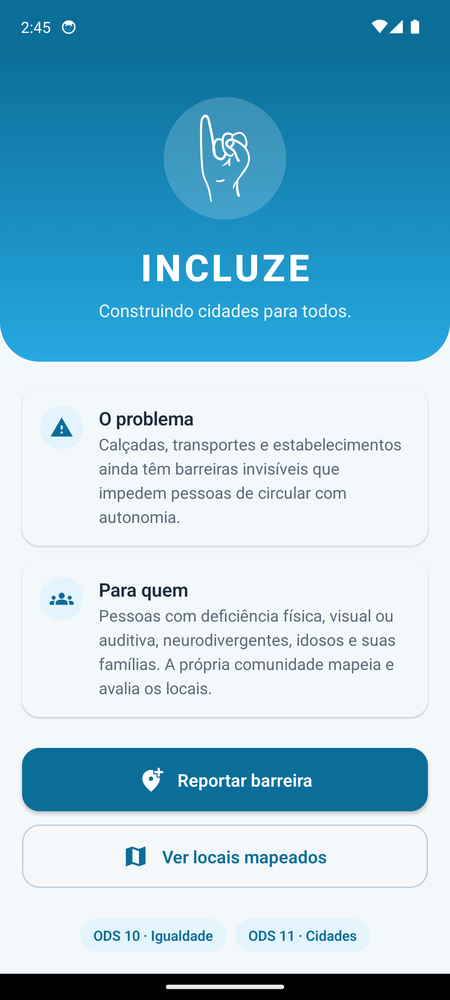
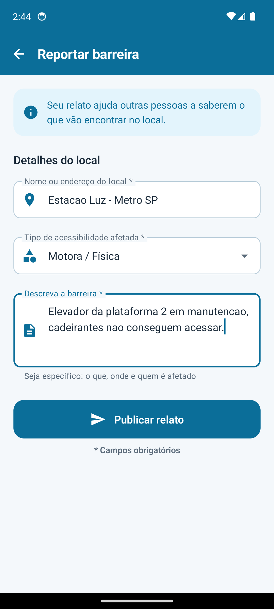
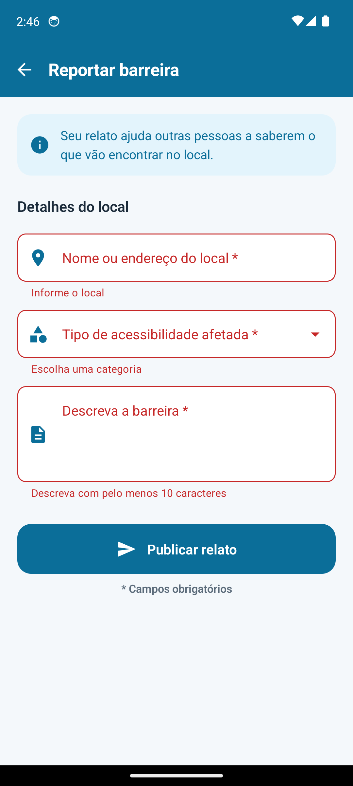
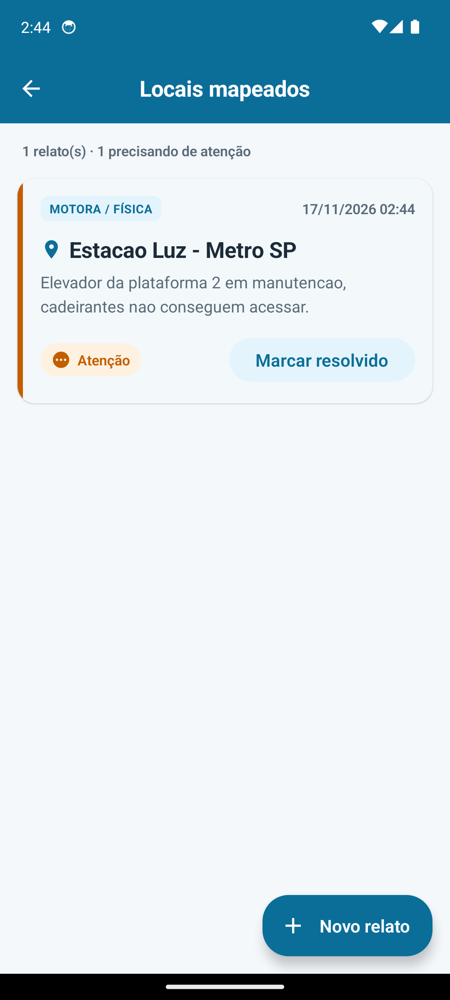
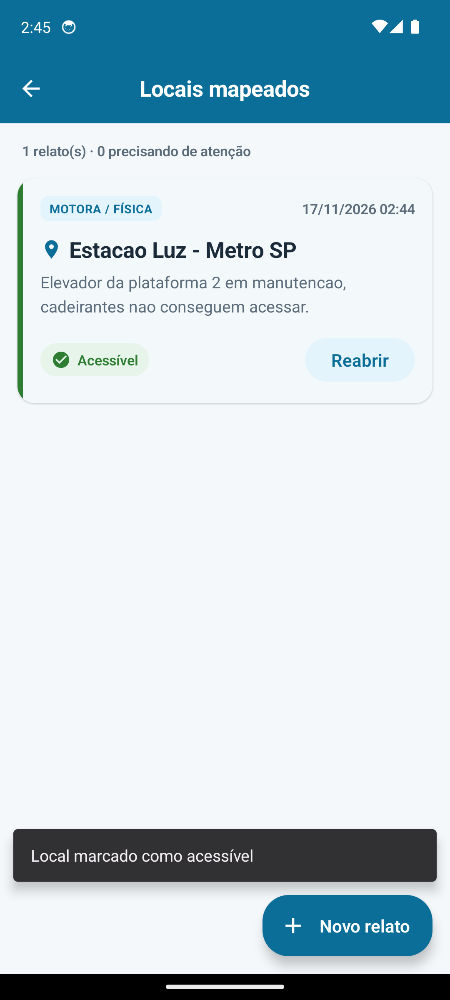
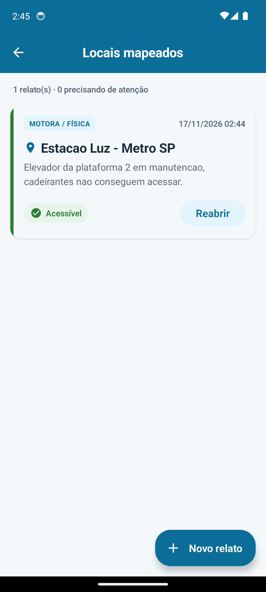

# INCLUZE - Plataforma CitizenTech de Acessibilidade

> Construindo cidades para todos.

## O Problema
As cidades e estabelecimentos não foram desenhados para todos. Pessoas com deficiência e neurodivergências enfrentam barreiras invisíveis (elevadores quebrados, calçadas sem rampa, falta de sinalização tátil ou sonora, ambientes com excesso de estímulos) no seu direito de ir e vir, e normalmente só descobrem isso quando já chegaram ao local.

## A Proposta
O INCLUZE é uma plataforma de crowdsourcing onde a própria comunidade mapeia, avalia e reporta as condições reais de acessibilidade de espaços. Assim, quem precisa consegue se planejar antes de sair de casa, e os dados reunidos podem apoiar políticas públicas (B2G) e o mercado (B2B).

## Público Beneficiado
Pessoas com deficiência (física, visual, auditiva), neurodivergentes, idosos, seus familiares e simpatizantes da causa.

## ODS Relacionados
- **ODS 10 (Redução das Desigualdades):** a meta 10.2 trata da inclusão social de todas as pessoas, independentemente de deficiência. O app reduz a desigualdade de acesso dando a pessoas com deficiência a mesma informação prévia sobre os locais que os demais já têm.
- **ODS 11 (Cidades e Comunidades Sustentáveis):** as metas 11.2 e 11.7 pedem transporte e espaços públicos acessíveis. Os relatos registrados mostram onde estão as barreiras, gerando dados para tornar o espaço urbano inclusivo e seguro.

## Funcionalidades
- **Tela inicial:** apresenta o app, o problema, o público e os ODS, com acesso às funções principais.
- **Reportar barreira (cadastro):** formulário com local, tipo de acessibilidade afetada e descrição. Todos os campos são obrigatórios e a descrição exige pelo menos 10 caracteres. Os erros aparecem em cada campo, e uma mensagem confirma o salvamento.
- **Locais mapeados (listagem):** lista os relatos em cards com categoria, data e status, mostra um resumo de quantos relatos precisam de atenção e tem um estado vazio quando não há registros.
- **Ação adicional:** cada relato pode ser marcado como **resolvido/acessível** ou **reaberto**. A interface muda na hora e uma Snackbar confirma a ação.
- **Persistência:** todos os relatos e seus status são salvos com Room e continuam disponíveis depois de fechar e reabrir o app.

## Fluxo principal
1. Na **tela inicial**, o usuário toca em **Reportar barreira**.
2. Preenche o formulário e toca em **Publicar relato**. O relato é salvo no Room.
3. Em **Ver locais mapeados**, o relato aparece na lista com o status "Atenção".
4. O usuário toca em **Marcar resolvido** e o status muda para "Acessível".
5. Ao fechar e abrir o app novamente, os relatos e o status continuam lá.

## Capturas de tela
Prints reais do app rodando no emulador (Pixel 6, Android 14). O último foi tirado depois de fechar o app à força e abrir de novo: o relato e o status "Acessível" continuam salvos pelo Room.

| Tela inicial | Cadastro | Validação |
|---|---|---|
|  |  |  |

| Lista com registro | Ação: marcar resolvido | Após reabrir o app |
|---|---|---|
|  |  |  |

## Tecnologias Utilizadas
- Kotlin
- Jetpack Compose + Material 3
- Navigation Compose
- Room (persistência local)
- ViewModel + StateFlow (gerenciamento de estado)

## Estrutura do projeto
```
com.aether.incluze
├── data
│   ├── local        -> ReportEntity, ReportDao, AppDatabase (Room)
│   └── repository   -> ReportRepository
└── ui
    ├── navigation   -> AppNavigation (NavHost)
    ├── report       -> ReportViewModel
    ├── screens      -> HomeScreen, ListScreen, FormScreen
    └── theme        -> cores, tipografia e tema da identidade INCLUZE
```

## Equipe (Grupo INCLUZE)
| Nome completo | RM |
|---|---|
| Breno Takase Gomes | RM_____ |
| Murilo Mercadante | RM_____ |

## Como executar
1. Abra o projeto no Android Studio.
2. Sincronize o Gradle.
3. Execute o aplicativo em um emulador ou dispositivo físico (Android 7.0+ / API 24).
